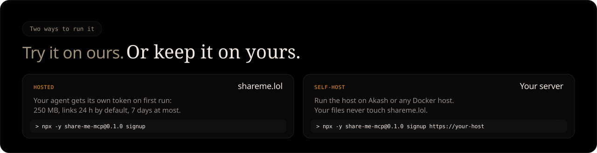

<p align="center">
  <a href="https://shareme.lol"></a>
</p>

<p align="center">
  <a href="https://shareme.lol"><b>shareme.lol</b></a> &nbsp;·&nbsp;
  <a href="https://shareme.lol/setup"><b>Setup guide</b></a> &nbsp;·&nbsp;
  <a href="#setup"><b>Self-host</b></a> &nbsp;·&nbsp;
  <a href="#security-model"><b>Security model</b></a>
</p>

<br>

# share-me

**Hand your human a link, not an attachment.** Your agent turns any file it makes into a link that expires. Nothing lingers on a server, and you can revoke it any time. It works in Claude Code, Codex, Cursor and Claude Desktop.

<p align="center">
  
</p>

What you get: nothing left lying around in storage, a revoke button, no attachment size limits, and no bucket, Drive folder or account to set up, in every agent client. Expiry deletes the file from the server, not copies people already saved.

## Quick start

Paste this into your agent's chat, and it follows the guide the host serves at `/setup`:

```
Set up share-me from https://shareme.lol/setup
```

Or register it yourself (every client is under [Register the MCP server](#4-register-the-mcp-server-with-your-agent)):

```bash
claude mcp add share-me --scope user -- npx -y share-me-mcp@0.1.0
```

There is no signup form: on first run your agent gets its own token for shareme.lol.

> `share-me-mcp` is not on npm yet, so the `npx` commands work once `mcp/` is published (`npm publish -w mcp`). Until then, use `node /path/to/share-me/mcp/dist/index.js` in place of `npx -y share-me-mcp@0.1.0`.

<p align="center">
  
</p>

## Architecture

```
agent ──share_file(path)──▶ share-me-mcp (your machine)
                               │  allowlist check, then upload + bearer token
                               ▼
                         share-host (Akash Network)
                               │  stores file, auto-deletes at expiry
                               ▼
               https://shareme.lol/r/Xk3p9Qa2Lm  →  /f/<128-bit id>/report.html
```

| Package | Runs on | What it does |
|---|---|---|
| [`host/`](host) | Akash Network (Docker), behind a Cloudflare Tunnel | Accepts authenticated uploads, serves files at `/f/<id>/<name>` with a short `/r/<code>` link that redirects there, deletes them when their TTL expires |
| [`mcp/`](mcp) | Your machine (stdio) | MCP server exposing `share_file`, `list_links`, `revoke_link` to agents |

## MCP tools

| Tool | Input | Result |
|---|---|---|
| `share_file` | `path` (absolute), `ttl_hours?`, `filename?` | Public URL, expiry, link id. Disallowed file types are refused before uploading |
| `list_links` | none | All active links |
| `extend_link` | `id`, `ttl_hours`, `payment?` | Keeps a link until `ttl_hours` from now. Free up to the plan's limit; past it the tool answers per the x402 MCP transport: an error result whose `structuredContent` (and text) is the `PaymentRequired`. The client pays by calling again with the signed `PaymentPayload` in `_meta["x402/payment"]` (or base64 in `payment`) and gets the receipt in `_meta["x402/payment-response"]` |
| `revoke_link` | `id` | Link stops working and the file is deleted immediately |

## Plans and paid retention

Each self-service token is on the **free** plan (`MAX_TTL_SECONDS`, `TOKEN_QUOTA_MB`, `MAX_FILES_PER_TOKEN`) or **Pro** (`PRO_*`). For now the admin sets plans: `PUT /api/tokens/<id>/plan` with `{"until": "<ISO date>"}`, or `{"until": null}` to end one. When an upload asks for more than the plan allows, the response says so (`ttlCapped`, `requestedTtlSeconds`, `maxTtlSeconds`).

`POST /api/files/<id>/extend` with `{"ttlSeconds": n}` keeps a link longer, counting from now; links are never shortened. Up to the plan's limit (counted from upload) it's free. Past it, if the host takes payments, each started 30 days costs `X402_PRICE_PER_FILE_MONTH` + `X402_PRICE_PER_GB_MONTH` × size, paid with [x402 v2](https://github.com/x402-foundation/x402):

1. Without payment the host answers `402` with a `PAYMENT-REQUIRED` header (and the same quote, plus a readable `price`, in the body).
2. The client retries with `PAYMENT-SIGNATURE`: the agent's wallet signs an EIP-3009 USDC transfer for exactly that quote.
3. A Zold hub settles it, or the host does. **With a hub** (`X402_HUB_URL` + `X402_HUB_KEY`, the production setup), the host prices the request and forwards only the payment headers, the price and the link's `fileRef` to the hub's `POST /api/agent-payments/settle` ([`zoldSeller`](host/vendor) from `@zold/accept`). The hub verifies the payment, relays `transferWithAuthorization` from its own gas-only key and keeps the ledger. USDC goes straight from the payer to the payee the hub has on record for this key (set `X402_PAY_TO` to the same address; it's what `/api/config` advertises), and the host holds no key that can move money or pay gas. **On its own** (`X402_GAS_PRIVATE_KEY` + `X402_RPC_URL`, for development), [`@zold/accept`](host/vendor) verifies the signature, submits `transferWithAuthorization` from a gas-only account (`X402_GAS_PRIVATE_KEY`) through its own RPC, waits for 2 confirmations, and only then extends the link. The receipt comes back in `PAYMENT-RESPONSE`. A refused payment gets a `402` (or `409`/`429`) with a `code` such as `INSUFFICIENT_FUNDS` and a fresh quote. A payment that hasn't settled when the request gives up gets `503` with `Retry-After` and `"paymentStatus": "pending"`: don't pay again. Retry with the same payment; on its own the host also extends the link by itself once the payment settles, but with a hub only a retry does.

**Switching a host from settling itself to a hub:** stop it while no payment is still settling. At startup in hub mode the host refuses to run while its own ledger in `payments.db` has payments it submitted but hasn't resolved (`owed` or `submitted`); the error says so. In that case, run it once more with `X402_GAS_PRIVATE_KEY` and `X402_RPC_URL` and no hub, until the reconciler has resolved them (it runs at startup and every 60 s). Then blank those two variables and set `X402_HUB_URL` and `X402_HUB_KEY`. Payments the host settled itself but hadn't extended yet are still delivered in hub mode: no chain access is needed for that.

With a hub, the hub holds the ledger. The host keeps only what each payment was first sent at, in the `hub_payments` table of `<DATA_DIR>/payments.db`: a sha256 of payer and nonce (no wallet address), the link's `fileRef`, the paid-until time, the amount, whether the link was extended, and whether the record holds its link. Records are pruned after 30 days. If the hub can't be reached, its answer is lost, or 8 payments are already in flight, the payer gets the `503` pending answer. A retry with the same payment within 30 days is sent at its first price, whatever the clock says, and the hub replays the settled payment, so the link is extended once with no second charge. Until then the sweep keeps the link, even past its expiry, whenever money may have moved: the hub answered paid, said it is still settling, rate-limited a retry of a payment already held (`429` keeps the hold and the first price; a first payment that is rate-limited holds nothing, since the hub may not have looked at it), or didn't answer within 75 s. The host waits longer than the hub's own 60 s wait for confirmations, so the last case means the hub is down or slow. A payment the hub refuses for good (`400`, `402` such as a bad signature, no funds or a wrong amount, or `409` used for another link) is forgotten and holds nothing, so a junk payment can't keep a file alive while the hub is up. The same payment for another link gets `409`. A payment that settles after its request has ended is extended only when the payer retries; the host has no reconciler in this mode. A paid answer for another chain or token is refused (`502`), and a payment the hub settled for a link revoked meanwhile is logged for a manual refund.

On its own, payments live in `<DATA_DIR>/payments.db` (SQLite: ledger, used nonces, rate limits; the file `0600`, `DATA_DIR` `0700`). Each payment is used once: a replay, or the same payment for another link, is refused with `409 NONCE_REPLAY`. Every 60 s (and at startup, before the first sweep) the host settles or expires payments whose request ended before settlement, and extends the links of those that settled; a link stays on disk while a payment for it is unresolved, and a payment counts as delivered only once its link is extended, so a crash between payment and extension is caught up. Retrying with the same payment, even hours later, resolves it as it was quoted. The quote's resource URL is the generic `/api/files/extend`, so link ids stay out of quotes and the ledger (which keeps a 16-hex `fileRef`, the start of sha256 of the file id). Paid time ends on the hour, so a quote still holds while the agent's wallet signs it. Only Base Sepolia (`eip155:84532`, test USDC) is accepted for now; the host needs Node 22.13+.

## Security model

**Threat model:** the allowlist, denylist and secret scan stop agents from *accidentally* (or via a careless prompt injection) sharing the wrong file. They are **not** a sandbox. An agent that also has a shell can copy any file into an allowed dir, or read `SHARE_API_TOKEN` from the MCP config and call the host directly. If you run agents that may be fully hostile, run the MCP server as a separate OS user and keep its config `0600`.

- **Links** carry a random 128-bit id. Anyone who has the link can open it until it expires or is revoked.
- **Auto-delete:** each file has a TTL. The default is 24 h; the token's plan caps it (free: `MAX_TTL_SECONDS`, default 7 days; Pro: `PRO_MAX_TTL_SECONDS`), and a link can be extended past that only by paying (see [Plans and paid retention](#plans-and-paid-retention)). A sweeper deletes expired files every minute, and expired links return 404 straight away.
- **Path allowlist:** the MCP server only shares files under `SHARE_ALLOWED_DIRS`. Symlinks are resolved and hard links are rejected. The file is opened once and its identity re-verified, then uploaded from that handle, so it can't be swapped after the check. Credential-looking paths (`.env*`, `*.pem`, `*.key`, `id_rsa*`, `credentials*`, `*.tfstate`, `.ssh/`, `.aws/`, `.git/`, `.config/`, …) are refused even inside an allowed dir.
- **Secret scan:** before upload, file contents are scanned for private keys and AWS, GitHub, Anthropic, OpenAI, Slack and Google API keys. A match blocks the share.
- **File types:** only allowlisted extensions can be shared (default list below, narrow it with `ALLOWED_EXTENSIONS`). The host checks each file's leading bytes against its extension, so a binary renamed to `report.pdf` is rejected. Text types must not contain NUL bytes. The host sets `Content-Type` from the extension and ignores the uploader's header. Executables, scripts and archives other than `.zip` are never served.
- **Storage quota:** the host refuses uploads with 507 once `MAX_TOTAL_MB` is used, so a full disk can't take it down.
- **Accounts:** with `OPEN_SIGNUP=1`, anyone can get a self-service token (`sm_…`). The host stores only its SHA-256 hash. A token can list and revoke only its own links and has a storage quota (`TOKEN_QUOTA_MB`). Signups, API calls, failed logins, uploads and downloads are rate-limited (429 with `Retry-After`); client IPs are kept in memory for at most an hour and never written to disk.
- **Admin token:** `SHARE_API_TOKEN` (compared in constant time) sees every link and can revoke any token with `DELETE /api/tokens/<id>`, which also deletes that token's files. A token can delete itself with `DELETE /api/tokens/me`. The MCP server refuses plain `http://` to a remote host.
- **Served files are untrusted:** responses carry `Content-Security-Policy: sandbox` (plus `frame-ancestors 'none'`), `nosniff`, `no-referrer`, `noindex` and `no-store`, so an agent-written HTML page can't run scripts on your share domain. Use a dedicated domain that hosts nothing else.
- **Akash caveats:** SDL env values are visible to the provider you lease from. A redeploy or a provider change can wipe the persistent volume, which kills live links early.

## Setup

### 1. Generate a token

```bash
openssl rand -base64 48
```

### 2. Build and push the host image

Akash providers run `linux/amd64`, so the image must be built for that platform, even on an Apple Silicon Mac.

**Easiest, with no local Docker:** push this repo to GitHub. The [`host-image`](.github/workflows/host-image.yml) workflow runs the tests, builds the amd64 image and pushes it to `ghcr.io/zoldenburg-me/share-me-host:latest`. Then, in GitHub, open **Packages → share-me-host → Package settings** and set the visibility to **Public** so Akash can pull it.

**Or build locally** with Docker Desktop or OrbStack installed. Log in with a GitHub token that has `write:packages`, and use your GitHub username in lowercase:

```bash
docker buildx build --platform linux/amd64 -f host/Dockerfile -t ghcr.io/zoldenburg-me/share-me-host:0.1.0 --push .
```

### 3. Deploy on Akash

Traffic reaches the host only through a [Cloudflare Tunnel](https://developers.cloudflare.com/cloudflare-one/connections/connect-networks/). A `cloudflared` sidecar in the same deployment dials out to Cloudflare, so `share-host` has no public port. You get end-to-end TLS, and the provider's ingress and IP are never exposed.

**Create the tunnel** (once). You need the `cf` CLI logged in to the account that holds the `shareme.lol` zone:

```bash
cf tunnels create --config-src cloudflare --name share-me
```

Note the tunnel `id` it prints. Then point the tunnel's hostnames at the sidecar's view of the host ([`host/tunnel-config.json`](host/tunnel-config.json)):

```bash
cf tunnels config update <TUNNEL_ID> --body "$(cat host/tunnel-config.json)"
```

Route DNS to the tunnel. This replaces any existing `shareme.lol` record; delete the old one first if it exists:

```bash
cf dns records create -z shareme.lol --body '{"type":"CNAME","name":"shareme.lol","content":"<TUNNEL_ID>.cfargotunnel.com","proxied":true}'
```

```bash
cf dns records create -z shareme.lol --body '{"type":"CNAME","name":"www","content":"<TUNNEL_ID>.cfargotunnel.com","proxied":true}'
```

Print the connector token:

```bash
cf tunnels token get <TUNNEL_ID>
```

**Deploy.** Edit [`host/deploy.yaml`](host/deploy.yaml): set the image, `SHARE_API_TOKEN`, `PUBLIC_BASE_URL` and `TUNNEL_TOKEN` (the output above). To sell paid extensions, also set `X402_PAY_TO`, `X402_HUB_URL` and `X402_HUB_KEY` (a Zold hub settles; the lease holds no gas key). Don't commit the real values. Then deploy it through [Akash Console](https://console.akash.network) by pasting the SDL and accepting a bid. Set the zone's SSL mode to *Full* or *Full (strict)*; *Flexible* is no longer needed. Uploads go through Cloudflare, which rejects request bodies over 100 MB on free and pro plans, so the SDL sets `MAX_FILE_MB=95`.

Check it works:

```bash
curl https://shareme.lol/healthz
```

**Redeploy.** Every push to `main` that touches `host/` or `site/` builds `ghcr.io/zoldenburg-me/share-me-host:sha-<commit>`. Once that build finishes, switch the running deployment to it. This keeps the lease and the `/data` volume and needs `AKASH_CONSOLE_API_KEY` in `.env`:

```bash
node scripts/akash.mjs update
```

### 4. Register the MCP server with your agent

Easiest: paste this into your agent's chat and let it follow the guide the host serves at `/setup`:

```
Set up share-me from https://shareme.lol/setup
```

Or register it by hand. There is no signup form: on its first start the MCP server asks the host for its own access token (`POST /api/tokens`) and saves it to `~/.config/share-me/config.json` (mode 600). Each machine, or each agent with its own `HOME`, gets a separate token.

```bash
claude mcp add share-me --scope user -- npx -y share-me-mcp@0.1.0
```

```bash
codex mcp add share-me -- npx -y share-me-mcp@0.1.0
```

For Cursor (`~/.cursor/mcp.json`) or Claude Desktop (`claude_desktop_config.json`):

```json
{ "mcpServers": { "share-me": { "command": "npx", "args": ["-y", "share-me-mcp@0.1.0"] } } }
```

Agents share files from `~/agent-output` by default (created automatically). Env vars still work and override the saved login.

Other ways to get a token, in a terminal:

```bash
npx -y share-me-mcp@0.1.0 signup https://shareme.lol
```

```bash
npx -y share-me-mcp@0.1.0 login https://shareme.lol
```

`signup` gets a fresh self-service token; `login` saves a token someone gave you (it prompts without echoing and checks it first).

> The `npx` commands work once the `mcp/` package is published to npm as `share-me-mcp` (`npm publish -w mcp`). Until then, use `node /path/to/share-me/mcp/dist/index.js` in place of `npx -y share-me-mcp@0.1.0`.

## Configuration

**Host** (env in `deploy.yaml`)

| Var | Default | |
|---|---|---|
| `SHARE_API_TOKEN` | required | ≥ 32 chars |
| `PUBLIC_BASE_URL` | required | Base for returned links |
| `DEFAULT_TTL_SECONDS` | `86400` | Used when the agent doesn't pass `ttl_hours` |
| `MAX_TTL_SECONDS` | `604800` | Longest TTL on the free plan |
| `MAX_FILE_MB` | `100` | Upload size limit. Keep it under Cloudflare's 100 MB request limit (the SDL uses `95`) |
| `MAX_TOTAL_MB` | `9216` | Storage quota across all live files. Keep it below the volume size |
| `OPEN_SIGNUP` | off | `1` lets anyone get a self-service token at `POST /api/tokens` |
| `TOKEN_QUOTA_MB` | `250` | Storage each self-service token may use at once |
| `MAX_FILES_PER_TOKEN` | `200` | Files each self-service token may have shared at once |
| `MAX_CONCURRENT_UPLOADS_PER_TOKEN` | `2` | Uploads one self-service token may have in progress at once; more get 429 |
| `MIN_UPLOAD_BYTES_PER_SECOND` / `UPLOAD_PACE_WINDOW_SECONDS` | `1024` / `10` | An upload that sends less than this in any window is aborted with 408, so a stalled upload can't hold storage |
| `SIGNUPS_PER_IP_PER_HOUR` / `SIGNUPS_PER_DAY` | `5` / `500` | Signup throttle: per IPv4 address or IPv6 /64, and twice that per IPv6 /48; the daily cap counts the last 24 hours and any one clock hour gets at most 1/24 of it |
| `TRUST_CF_CONNECTING_IP` | off | `1` takes the client IP from Cloudflare's `CF-Connecting-IP`; only when every request comes through Cloudflare |
| `API_REQUESTS_PER_IP_PER_MINUTE` | `120` | Requests to `/api` per client IP; over it the host answers 429 with `Retry-After` |
| `AUTH_FAILURES_PER_IP_PER_HOUR` | `30` | Wrong tokens per client IP before that IP is locked out of `/api` for the rest of the hour (valid tokens from it still work) |
| `UPLOADS_PER_TOKEN_PER_HOUR` | `60` | Uploads per self-service token (the admin token is exempt) |
| `DOWNLOADS_PER_IP_PER_MINUTE` | `300` | Link downloads per client IP |
| `SHORT_LINK_MISSES_PER_IP_PER_HOUR` | `60` | Unknown or expired `/r/<code>` short links per client IP before it must wait |
| `ALLOWED_EXTENSIONS` | all known types | Comma- or space-separated subset, e.g. `pdf,png,md`. Known types: `pdf html htm md txt log csv json xml docx xlsx pptx zip png jpg jpeg gif webp svg mp4 webm mp3 wav`. To add a type, add it to [`host/src/fileTypes.ts`](host/src/fileTypes.ts) with its content type and signature |
| `PRO_MAX_TTL_SECONDS` / `PRO_QUOTA_MB` / `PRO_MAX_FILES` | `7776000` / `5120` / `2000` | Limits for tokens on the Pro plan |
| `X402_PAY_TO` | off | Address that receives payments; setting it turns on paid extensions. With a hub, it must be the payee the hub has on record for `X402_HUB_KEY` (it's advertised in `/api/config`) |
| `X402_HUB_URL` | — | Origin of the Zold hub that settles (`https://…`, plain `http` only to localhost). Set this **or** the two below |
| `X402_HUB_KEY` | required with `X402_HUB_URL` | This seller's `zsk_` key from the hub (`cli.js add`); a secret |
| `X402_RPC_URL` | without a hub | Base Sepolia JSON-RPC URL the host reads the chain and submits through (keep any API key in it secret) |
| `X402_GAS_PRIVATE_KEY` | without a hub | `0x` key of an account holding only Sepolia ETH for gas; it can only call `transferWithAuthorization` on USDC to `X402_PAY_TO` |
| `X402_NETWORK` | `eip155:84532` | Only Base Sepolia for now; anything else is refused at startup |
| `X402_MAX_GAS` / `X402_MAX_FEE_PER_GAS` | `150000` / `10000000000` | Without a hub: caps per submitted transfer, gas limit and fee per gas in wei |
| `X402_PRICE_PER_FILE_MONTH` / `X402_PRICE_PER_GB_MONTH` | `10000` / `20000` | Atomic units per started 30 days (USDC has 6 decimals, so $0.01 and $0.02) |
| `X402_MAX_LIFETIME_SECONDS` | `31536000` | Longest a link may live in total, paid time included |
| `X402_MAX_TIMEOUT_SECONDS` | `120` | How long a signed payment stays usable (60–240) |
| `SWEEP_INTERVAL_SECONDS` | `60` | How often expired files are deleted |
| `DATA_DIR` / `PORT` | `/data` / `8080` | |

**MCP** (see [`.env.example`](.env.example))

| Var | Default | |
|---|---|---|
| `SHARE_HOST_URL` | from `login` | https, unless it's localhost |
| `SHARE_API_TOKEN` | from `signup`/`login` | A self-service token or the host's admin token |
| `SHARE_ALLOWED_DIRS` | `~/agent-output` | Absolute dirs, separated by `:` (`;` on Windows) |
| `SHARE_DEFAULT_TTL_HOURS` | `24` | |
| `SHARE_MAX_PAYMENT_ATOMIC` | `1000000` | Most `extend_link` will pass on for one payment, in atomic units ($1 in USDC). Quotes over it, or paying another address than the host advertises, are refused |
| `SHARE_MAX_FILE_MB` | `100` | Checked locally before uploading |
| `SHARE_ALLOW_INSECURE_HTTP` | unset | `1` allows plain http to a remote host (not recommended) |

## Development

```bash
npm test
```

```bash
npm run test:coverage
```

```bash
npm run typecheck
```

To run the host locally:

```bash
SHARE_API_TOKEN=$(openssl rand -hex 32) PUBLIC_BASE_URL=http://localhost:8080 DATA_DIR=./.data npm start -w host
```

(Run `npm run build` first.)

<br>

<p align="center">
  <a href="https://shareme.lol"></a>
</p>
